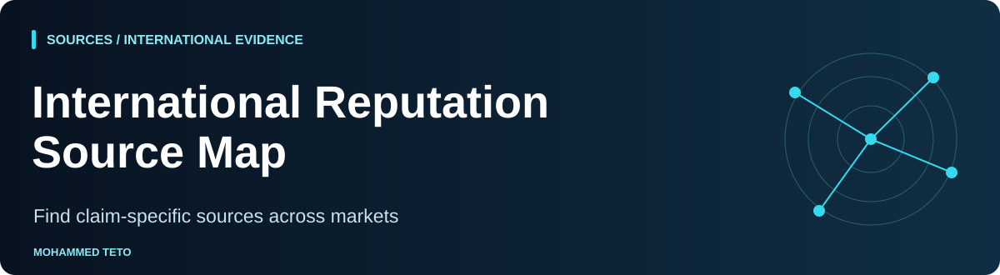

<p align="center"></p>

# International Reputation Source Map

[](https://github.com/mhdteto/international-reputation-source-map/actions/workflows/validate.yml)


**A curated starting catalogue for international identity, evidence and source research.**

Find an appropriate official entry point for a particular claim, then inspect the actual record and its scope. The initial catalogue contains **16 entries** covering the United States, United Kingdom, Canada, France, United Arab Emirates and Morocco, plus global research identity and publication resources.

[Source CSV](data/sources.csv) · [Generated catalogue](examples/report/report.html) · [Selection method](docs/curation-method.md) · [How to use it](docs/research-workflow.md)

<!-- shared-nav -->
<p>
  <a href="https://mohammedteto.com"></a>
  <a href="https://mohammedteto.com/method/"></a>
  <a href="https://mohammedteto.com/research/"></a>
</p>

<!-- suite-navigation -->
## Start here: this repository in the workflow

**Your task:** Find sources appropriate to a specific claim and market.

[Method →](https://github.com/mhdteto/authority-architecture-system) · [Audit →](https://github.com/mhdteto/search-ai-discoverability-checker) · [Structure →](https://github.com/mhdteto/entity-structured-data-kit) · [Measure →](https://github.com/mhdteto/ai-citation-tracker)

**Next step:** [authority-evidence-mapper](https://github.com/mhdteto/authority-evidence-mapper) — Record the actual source review; a catalogue entry is not verification.

**Try it:** [complete fictional workflow](https://github.com/mhdteto/authority-architecture-system/tree/main/examples/fictional-workflow). All scenario records and engine answers are invented; generated reports are real CLI output.

**Python CI:** 3.10 / 3.13. The badge links to the real workflow; it describes automated checks, not ranking, factual accuracy or AI visibility.
[Map of all eight resources](https://github.com/mhdteto/authority-architecture-system/blob/main/docs/tool-map.md) · [Open an issue](https://github.com/mhdteto/international-reputation-source-map/issues/new/choose)
<!-- /suite-navigation -->

## What each entry provides

Market, source category, publisher, destination, claim-specific use, limitations, access notes, research date and a primary verification reference. Verification levels distinguish a page actually read from an official link or indexed description. A blocked service is not described as successfully tested.

The catalogue contains entry points and original curation notes, not company or personal records. Inclusion does not imply endorsement, eligibility for listing, a backlink opportunity, or expected search/AI visibility.

## Build the offline catalogue

Requires Python 3.10+; no dependencies, account, API key or network request.

```sh
python3 build.py data/sources.csv --as-of 2026-11-01 --output-dir examples/report
python3 -m unittest discover -s tests -v
```

Open `examples/report/report.html` locally to search and filter the standalone catalogue. JSON is generated alongside it. JavaScript only filters the already embedded cards; without JavaScript all sources remain readable. The compiler does not fetch or reverify links.

The chosen date is the research snapshot, not an assertion that services remain unchanged. The CLI rejects invalid input and input/output collisions before writing; valid runs overwrite report.json and report.html in the selected directory. A filesystem error may leave partial exports.

## Coverage and scope

| Market | Initial entry points |
| :--- | :--- |
| United States | SEC filing search; USPTO patent search guidance |
| United Kingdom | Companies House route; FCA register guidance |
| Canada | Federal corporation search; SEDAR+ public disclosure route |
| France | Annuaire des Entreprises; DATA INPI |
| United Arab Emirates | Government licence-query guide; ADGM registers |
| Morocco | OMPIC/DirectInfo route; AMMC issuer resources |
| Global | ORCID; Crossref; ROR; OpenAlex |

The sources do different jobs. A corporate record can help establish legal identity within its coverage; it is not proof of professional merit. An index helps discover candidate material; it does not certify every relationship it contains. Inspect the actual claim, entity and relevant dates.

## Verification limits

Research was checked on **1 November 2026**. Some official services could not be read directly by the research tool; those entries retain explicit indexed/link-only verification notes. No logins, purchases, registrations, paid document requests or entity-level due diligence were performed. Prices, eligibility and search interfaces were not exhaustively assessed.

See [verification notes](docs/verification-notes.md) and [data format](docs/data-format.md). This is not a legal, investment or regulatory assessment.

## Use with the broader method

Created by **Mohammed Teto — AI Reputation & Authority Strategist**, serving leaders and organizations internationally. [Markets](https://mohammedteto.com/markets/) · [Method](https://mohammedteto.com/method/) · [Authority Evidence Mapper](https://github.com/mhdteto/authority-evidence-mapper).

Use the catalogue to identify possible sources, then record human-reviewed evidence against specific claims in the mapper. Do not substitute catalogue inclusion for source-level review.

Code: [MIT](LICENSE). Original documentation, curated notes and artwork: [CC BY 4.0](LICENSE-DOCS.md). Third-party sites and records retain their own rights. [Contributing](CONTRIBUTING.md).
